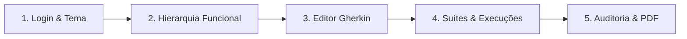

# 🧪 Gestor de Testes Corporativo (Self-Hosted)

<div align="center">


<p align="center">
  <strong>Plataforma corporativa on-premise de governança de qualidade, gestão BDD/Gherkin, orquestração de suítes de teste e auditoria imutável de evidências.</strong>
</p>

[Visão Geral](#-visão-geral) •
[Início Rápido](#-início-rápido-em-3-minutos) •
[Perfis & Acessos](#-perfis-rbac-e-credenciais-demo) •
[Guia de Uso](#-guia-passo-a-passo-como-usar-o-sistema) •
[Arquitetura](#-arquitetura--tecnologias) •
[Testes Automatizados](#-testes-automatizados)

</div>

---

## 🎯 Visão Geral

O **Gestor de Testes Corporativo** foi concebido para resolver o gargalo da rastreabilidade e governança de qualidade em ambientes de engenharia de software corporativos:

- 🔒 **Self-Hosted & Seguro**: Cookies `HttpOnly`, `SameSite=Strict`, isolamento total de rede intranet e sem telemetria externa.
- 🌳 **Hierarquia Funcional de 4 Níveis**: Navegação intuitiva `Projeto` ➔ `Módulo` ➔ `Página` ➔ `Funcionalidade` com reordenação Drag-and-Drop em lote e persistência diferida.
- 📝 **Editor BDD Gherkin em Tempo Real**: Parser sintático colorido com versionamento imutável (`v1, v2, ...`) a cada edição.
- ⚡ **Orquestrador de Execução de Suítes**: Baterias de teste dinâmicas, mecânica de pausa e retomada (*Save & Resume*), selo de estabilidade (`ESTÁVEL` vs `INSTÁVEL`) e barra de progresso.
- 🛡️ **Governança Estrita de Execuções**:
  - `PASSED` / `FAILED`: Obrigatório anexo de no mínimo 1 evidência ativa (PNG, JPG, MP4, LOG).
  - `BLOCKED` / `SKIPPED`: Trava de segurança que exige justificativa técnica minuciosa ($\ge 70$ caracteres).
- 📜 **Linha do Tempo de Auditoria (Líder)**: Substituição auditada de evidências (`PATCH /evidences` com parecer $\ge 70$ caracteres) preservando o histórico e a imutabilidade do status do teste.
- 📄 **Relatório Executivo PDF no Navegador**: Geração local instantânea em PDF via `jsPDF` com gráficos, métricas consolidadas e detalhamento por módulo.

---

## 🚀 Início Rápido (em 3 minutos)

### Pré-requisitos
- [Docker](https://docs.docker.com/get-docker/) & [Docker Compose](https://docs.docker.com/compose/) instalados
- Portas disponíveis: `3000` (Frontend), `8000` (API Gateway) e `5432` (PostgreSQL)

### 1. Clonar o repositório
```bash
git clone https://github.com/eurenanpullig/QA_manager.git
cd QA_manager
```

### 2. Configurar variáveis de ambiente
```bash
cp .env.example .env
```

### 3. Subir todos os serviços com Docker Compose
```bash
docker compose up -d --build
```

### 4. Acessar a aplicação
- 🌐 **Interface Web (React App):** [http://localhost:3000](http://localhost:3000)
- 🔌 **API Gateway:** [http://localhost:8000](http://localhost:8000)

> [!TIP]
> O banco de dados PostgreSQL já sobe inicializado e populado automaticamente com extensões `uuid-ossp`, `pgcrypto`, tabelas DDL e usuários padrão pré-cadastrados.

---

## 👥 Perfis RBAC e Credenciais Demo

O sistema implementa o padrão **Controle de Acesso Baseado em Papéis (RBAC)** estrito. Todas as senhas iniciais de homologação são: `Admin@123`.

Na tela de login há botões de **Acesso Rápido** para alternar facilmente entre perfis:

| Papel | E-mail de Demonstração | Permissões Principais |
| :--- | :--- | :--- |
| **Líder de Testes** (`LIDER_TESTES`) | `lider@gestortestes.local` | Cria projetos raiz, gerencia hierarquia, cria suítes, executa testes, **substitui evidências na auditoria** e exporta PDF. |
| **Analista QA** (`QA`) | `qa@gestortestes.local` | Cadastra módulos/páginas/features, escreve cenários Gherkin, cria suítes e registra execuções com evidências. |
| **Desenvolvedor** (`DEV`) | `dev@gestortestes.local` | Perfil **Read-Only**: consulta cenários, suítes, execuções e histórico de auditoria (sem poder de mutação). |
| **Administrador** (`ADM`) | `admin@gestortestes.local` | Gestão de Usuários (CRUD de contas e atribuição de perfis) via tela restrita. Não altera dados de testes. |

---

## 📖 Guia Passo a Passo: Como Usar o Sistema



### 1️⃣ Autenticação e Personalização Visual
1. Acesse [http://localhost:3000](http://localhost:3000).
2. Clique em **"Líder de Testes"** no card de acesso rápido e clique em **"Entrar no Sistema"**.
3. No cabeçalho superior você pode:
   - Alternar entre **Modo Escuro (🌙)** e **Modo Claro (☀️)**.
   - Ajustar a **Escala de Fonte** de `80%` a `150%` com adaptação automática de layout.

---

### 2️⃣ Gestão da Hierarquia Funcional (4 Níveis)
Navegue pelo menu **"Hierarquia Funcional"**:
- **Projetos Raiz**: Selecione um projeto existente no seletor ou crie um novo (exclusivo do Líder).
- **Árvore Funcional**: Visualize a estrutura organizada em `Módulos` ➔ `Páginas` ➔ `Funcionalidades`.
- **Drag-and-Drop Inteligente**: Reordene módulos arrastando-os verticalmente. O sistema utiliza um **motor de persistência diferida** com debounce de 5 minutos, salvamento ao trocar de rota e garantia no evento `beforeunload`.
- **Acesso Rápido ao Gherkin**: Clique no botão azul `Gherkin ➔` em qualquer funcionalidade para abrir o editor já contextualizado.

---

### 3️⃣ Editor BDD Gherkin & Histórico de Versões
Acesse **"Editor Gherkin & Versões"**:
1. Escolha a **Funcionalidade Vinculada** e visualize os cenários existentes.
2. Crie ou edite a especificação BDD usando a sintaxe clássica:
   ```gherkin
   Feature: Autenticação de Usuários
     Scenario: Login válido com emissão de Cookie Seguro
       Given que o usuário corporativo informa e-mail válido
       When preenche a senha correta
       Then o sistema emite o cookie de sessão HttpOnly
   ```
3. O painel lateral direito renderiza o **Preview BDD Colorido** em tempo real com realce de sintaxe das palavras-chave.
4. Ao clicar em **"Salvar"**, o sistema cria atomicamente um novo snapshot imutável (`v1`, `v2`, etc.).
5. Use os botões de versões anteriores no rodapé para auditar alterações históricas do cenário!

---

### 4️⃣ Orquestrador de Baterias de Teste e Execução
Acesse **"Suítes & Execuções"**:
1. **Montagem de Suíte Dinâmica**:
   - Dê um nome à suíte (ex: `Regressão Release v1.2`).
   - Marque os cenários desejados de qualquer funcionalidade do projeto.
   - Clique em **"+ Criar Suíte Dinâmica"**.
2. **Executar Bateria**:
   - Clique em **"▶ Executar Bateria"** na lista de suítes.
   - Acompanhe a **Barra de Progresso** e o **Selo de Estabilidade** (`ESTÁVEL` quando $\ge 70\%$ dos testes passam).
   - Use o botão **"⏸ Pausar Bateria"** para interromper a execução e retome a qualquer momento pelo botão **"⏯ Retomar Bateria"**.
3. **Registro Imutável da Execução**:
   - Clique em **"Registrar Execução"** em qualquer item da pilha.
   - **Caso PASSED ou FAILED**: Anexe obrigatoriamente um arquivo de evidência (imagem, log ou vídeo). O botão só é liberado após o upload!
   - **Caso BLOCKED ou SKIPPED**: Digite a justificativa técnica. O sistema conta os caracteres e só libera o envio com **no mínimo 70 caracteres**.

---

### 5️⃣ Auditoria do Líder & Relatórios Executivos em PDF
Acesse **"Auditoria & Relatórios PDF"**:
1. **Substituição Auditada de Evidências (Exclusivo Líder de Testes)**:
   - Selecione a execução que deseja sanear.
   - Faça o upload da nova evidência corrigida (ex: imagem sem dados sensíveis).
   - Insira o parecer de auditoria formal no campo `comment_audit` ($\ge 70$ caracteres obrigatórios).
   - O sistema arquiva a evidência anterior, ativa a nova e registra a **Trilha de Auditoria**, mantendo o status original da execução inalterado.
2. **Exportação de Relatório Executivo PDF**:
   - Selecione o projeto e informe o escopo (ex: `Homologação Sprint 24`).
   - Clique em **"Exportar Relatório PDF"**.
   - O documento é compilado instantaneamente no cliente (`jsPDF`) contendo cabeçalho executivo, volumetria, barra de taxa de sucesso/falha e detalhamento consolidado.

---

## 🏛️ Arquitetura & Tecnologias

A solução é desenhada sobre um ecossistema de microsserviços desacoplados e conteinerizados:

```
                      ┌────────────────────────┐
                      │    Navegador Web       │
                      │  React 18 + Vite (SPA) │
                      └───────────┬────────────┘
                                  │ :3000
                                  ▼
                      ┌────────────────────────┐
                      │    gt_gateway (:8000)  │
                      │  Helmet, CORS, JWT-Val │
                      └───────────┬────────────┘
         ┌────────────────────────┼────────────────────────┐
         ▼                        ▼                        ▼
┌─────────────────┐      ┌─────────────────┐      ┌─────────────────┐
│ gt_auth_service │      │gt_project_serv. │      │gt_test_execution│
│     (:5001)     │      │     (:5002)     │      │     (:5003)     │
└────────┬────────┘      └────────┬────────┘      └────────┬────────┘
         │                        │                        │
         └────────────────────────┼────────────────────────┘
                                  ▼
                      ┌────────────────────────┐      ┌─────────────────┐
                      │      gt_postgres       │      │gt_storage_serv. │
                      │  PostgreSQL 15 (:5432) │      │  Vol: /uploads  │
                      └────────────────────────┘      └─────────────────┘
```

| Componente | Diretório | Tecnologias Principais | Descrição |
| :--- | :--- | :--- | :--- |
| **Frontend** | `/frontend` | React 18, Vite, TypeScript, jsPDF | Interface responsiva, WCAG 2.1 AA, tokens CSS e zero cantos 90°. |
| **API Gateway** | `/gateway` | Express, Helmet, CORS, Cookie-Parser | Ponto único de entrada, validação de tokens JWT e injeção de headers RBAC. |
| **Auth Service** | `/services/auth-service` | Express, bcrypt, JWT | Autenticação, proteção contra força bruta progressiva e gestão de usuários. |
| **Project Service** | `/services/project-service` | Express, pg | CRUD hierárquico de 4 níveis, soft delete e batch order drag-and-drop. |
| **Test Service** | `/services/test-execution-service` | Express, pg | Engine Gherkin, imutabilidade, suítes dinâmicas e auditoria de evidências. |
| **Storage Service** | `/services/storage-service` | Busboy, Node Crypto/fs | Upload multipart atômico com validação de quotas (30MB/200MB/10MB). |
| **Database** | `/init-scripts` | PostgreSQL 15 | 12 tabelas relacionais, 23 índices de alta performance e seeders automáticos. |

---

## 🧪 Testes Automatizados

O projeto conta com pirâmide de testes completa e automatizada:

### Testes End-to-End (Cypress)
Executados via contêiner headless oficial `cypress/included`:
```bash
docker run --rm --network host -v "$PWD":/e2e -w /e2e --entrypoint cypress cypress/included:13.16.0 run --config-file cypress.config.mjs
```
- ✅ **Spec 1:** Fluxo completo: Login ➔ Projeto ➔ Cenário Gherkin ➔ Execução PASSED com Upload.
- ✅ **Spec 2:** Trava de segurança que impede justificativa curta (< 70 caracteres) para `BLOCKED`.
- ✅ **Spec 3:** Substituição auditada de evidência pelo Líder e geração do relatório PDF no cliente.
- **Taxa de Sucesso:** **100% de aprovação (3/3 specs)**.

### Testes de Integração de API (Robot Framework)
Executados via contêiner Python:
```bash
docker run --rm --network host -v "$PWD":/workspace -w /workspace python:3.12-slim sh -c \
  "pip install -q -r tests/robot/requirements.txt && robot -d robot-results tests/robot/backend_integration.robot"
```
- ✅ **Taxa de Sucesso:** **100% de aprovação (5/5 testes)**.

---

## 🛠️ Comandos Úteis de Desenvolvimento

```bash
# Ver status dos contêineres
docker compose ps

# Visualizar logs em tempo real
docker compose logs -f

# Rodar verificação de lint em todo o monorepo (0 warnings/erros)
npm run lint

# Formatar código com Prettier
npm run format

# Parar todos os serviços
docker compose down

# Reiniciar limpando volumes (reset completo do banco de dados)
docker compose down -v && docker compose up -d --build
```

---

<div align="center">
  <sub>Desenvolvido com foco em Governança, Imutabilidade e Alta Produtividade em QA.</sub>
</div>
